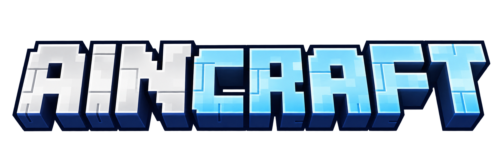
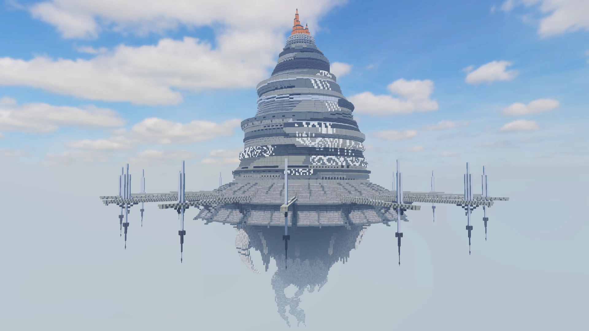

  

AINCRAFT is a Minecraft Java project I'm working on, inspired by Sword Art Online and Aincrad. I'm building the game and a Windows launcher for it. Both are still in development.

## The launcher

I want players to be able to open the launcher, install the right files, sign in with their Minecraft account, and join AINCRAFT.

The current build uses Minecraft Java 1.21.4, Fabric 0.20.0, and Java 21 on Windows x64. It keeps AINCRAFT in its own game folder and prepares the Java runtime during installation. Play only appears when the required files are present and complete. There is also a file check and repair option for broken or interrupted downloads.

The interface uses the AINCRAFT logo, a Minecraft screenshot of Aincrad, and pixel fonts. The screenshot above is the one currently used in the launcher.

## Minecraft account sign-in

AINCRAFT has its own Microsoft application registration. Players won't need to set up an Azure app or enter a client ID themselves.

Sign-in uses MSAL's device-code flow. The player opens Microsoft's website, enters the code shown in the launcher, and signs in there. Their Microsoft password is never entered into AINCRAFT.

The launcher requests `XboxLive.signin`, completes the Xbox Live and XSTS exchange, and calls Minecraft Services for a session and Java profile. If it doesn't receive a valid Java profile, it won't launch the game. Minecraft Services access is needed for those authentication and profile requests.

Tokens are handled in the Electron main process. The interface only receives the player's public profile. The local MSAL cache is encrypted using Windows account storage, and Disconnect deletes that local cache. The launcher doesn't request access to mail, contacts, calendars, or cloud files.

For Microsoft's review:

- Application name: **AINCRAFT**
- Public client ID: `9cdecb3f-dda2-46ab-81ce-8104ed0762c8`
- Account type: personal Microsoft accounts
- Authentication: public desktop client, device-code flow, no client secret

The app registration is set up and Microsoft's device-code endpoint has been tested. Minecraft Services approval and a full sign-in and gameplay test are still needed. I haven't marked those as working yet.

## What's public here

This repo contains the project description, logo, and Minecraft screenshot. The source code, game files, and launcher builds are still private. There are no public releases or downloads yet.

Questions about the project can go in [Issues](https://github.com/Lorrxx/AINCRAFT/issues).

---

AINCRAFT is an independent fan project, not an official Minecraft or Sword Art Online product. It is not affiliated with Mojang, Microsoft, or the Sword Art Online rights holders.
